


 

 

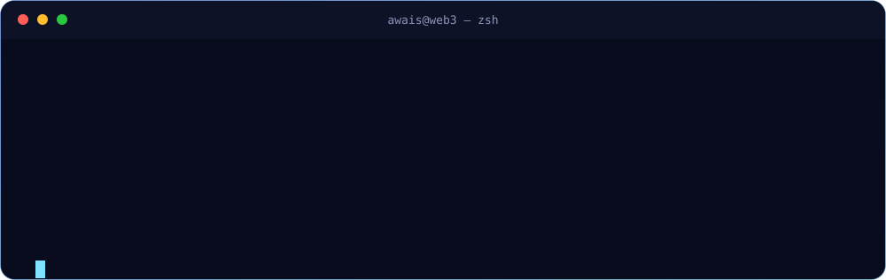

  


 


 

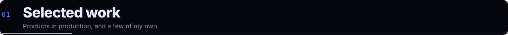

<a href="https://zer0browser.org/"></a>

<a href="https://zovereign.org/"></a>
<a href="https://pro.biokript.com/"></a>
<a href="https://www.store.bugatticollectionsnft.com/"></a>
<a href="https://utilitybridge.co.uk/"></a>
<a href="https://nextwavecomm.com/"></a>
<a href="https://app.gradient.trade/"></a>

Professional projects were built within teams. Full case studies live on my <a href="https://itx-awais-dev.vercel.app/">portfolio</a>.

 

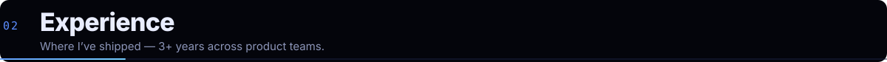

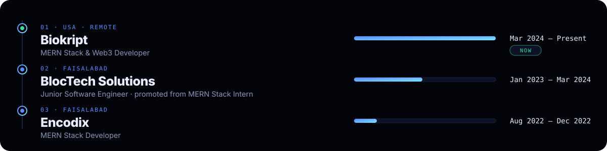

 

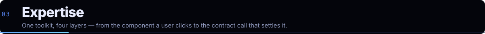

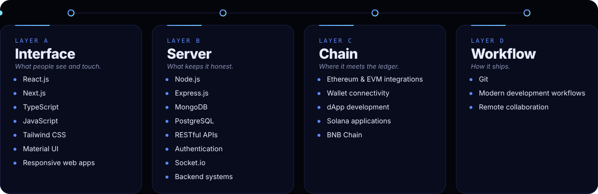


 

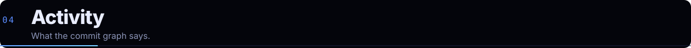

<picture>
  <source media="(prefers-color-scheme: light)" srcset="https://raw.githubusercontent.com/awais5588/awais5588/output/github-snake.svg"/>
  
</picture>

 

 

<a href="mailto:Awaisjaved5588@gmail.com"></a>

